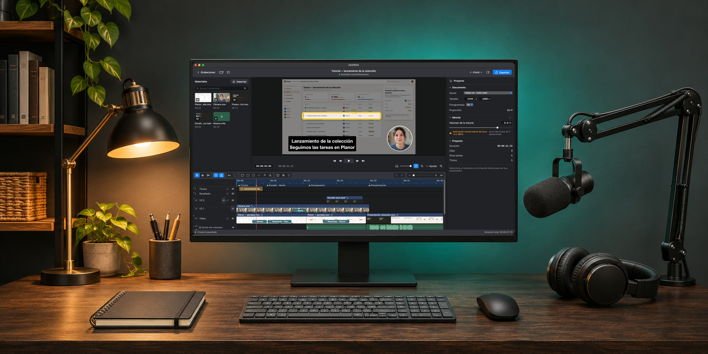
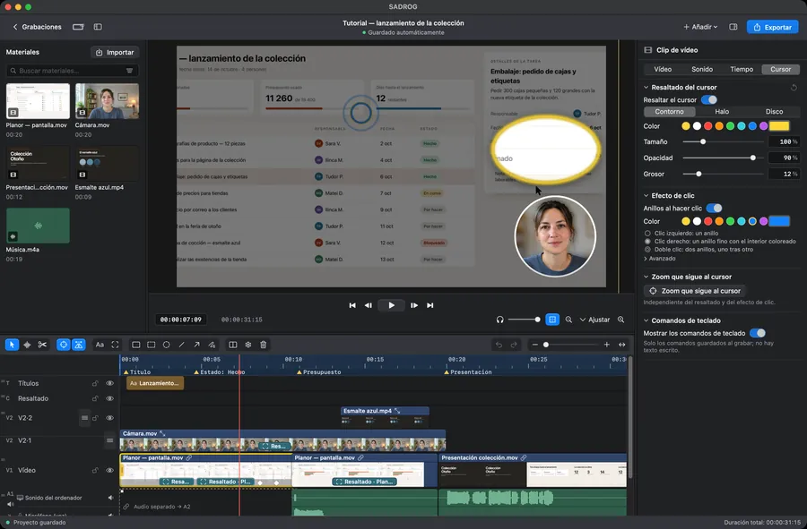
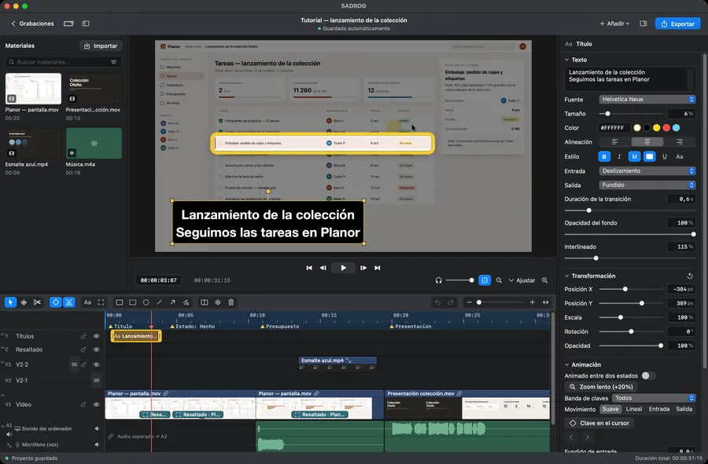
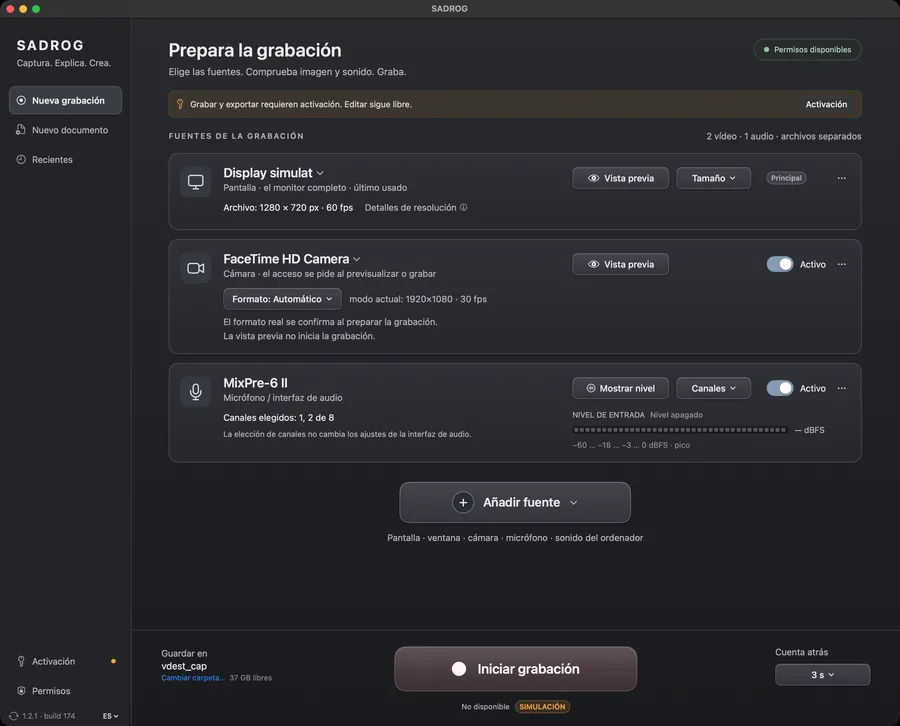
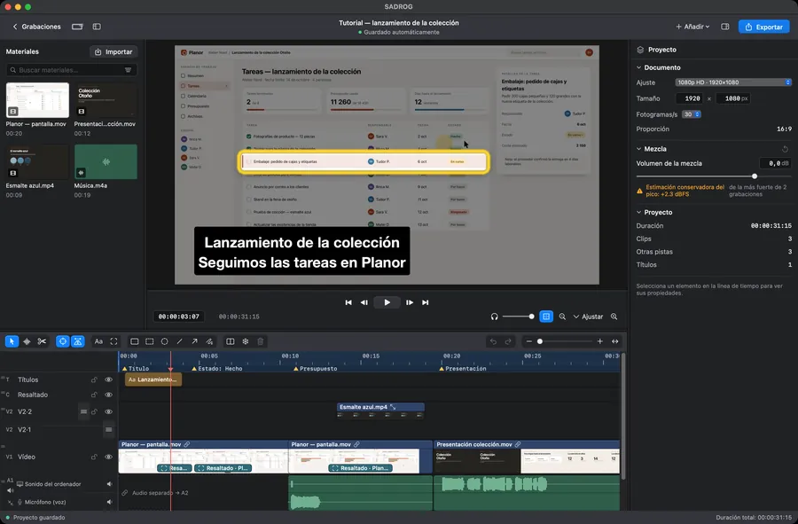
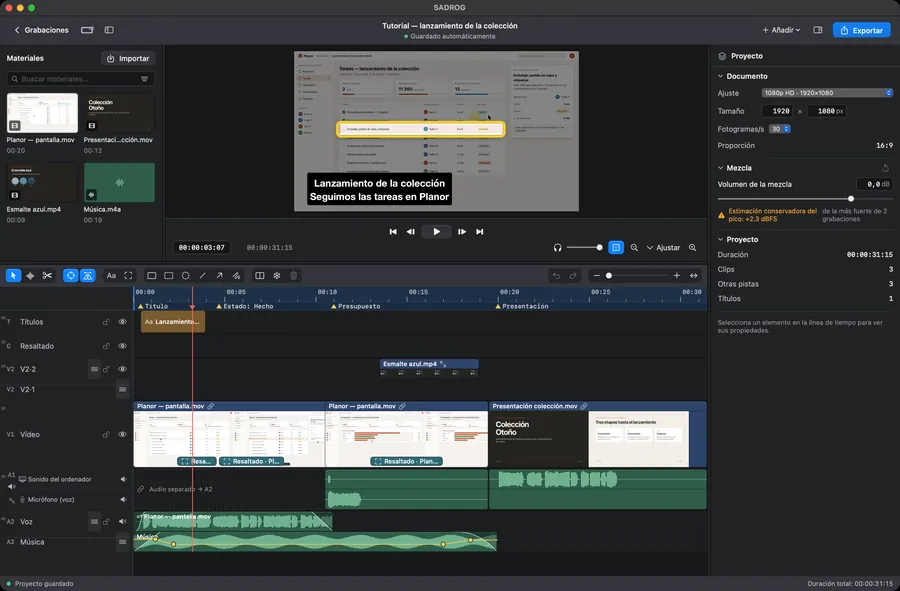
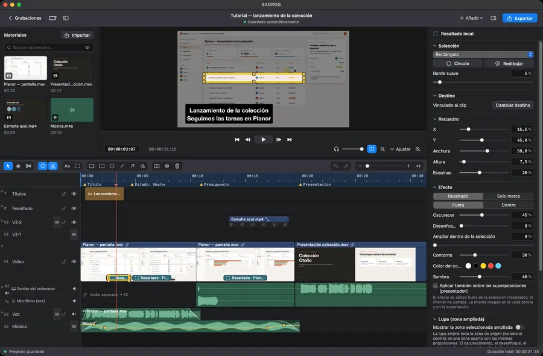
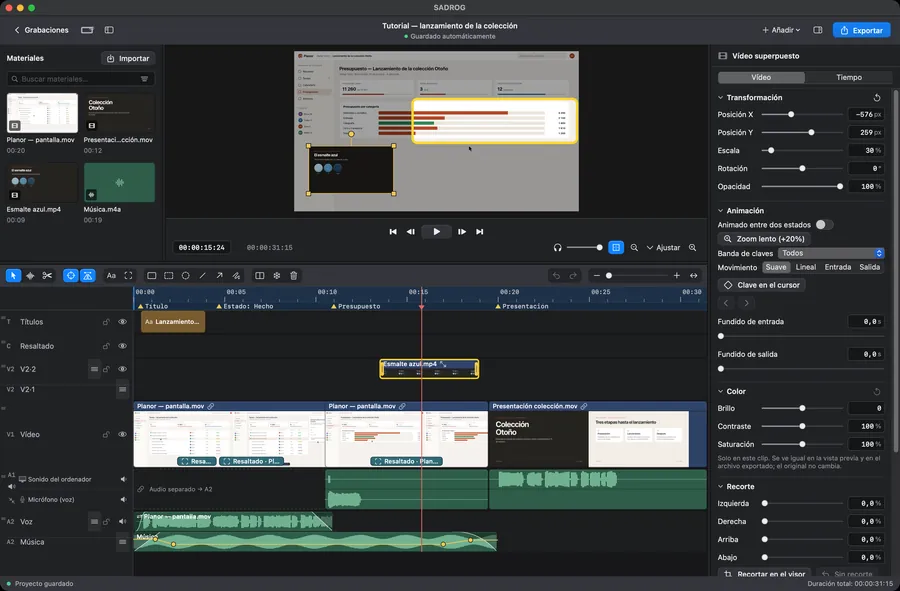
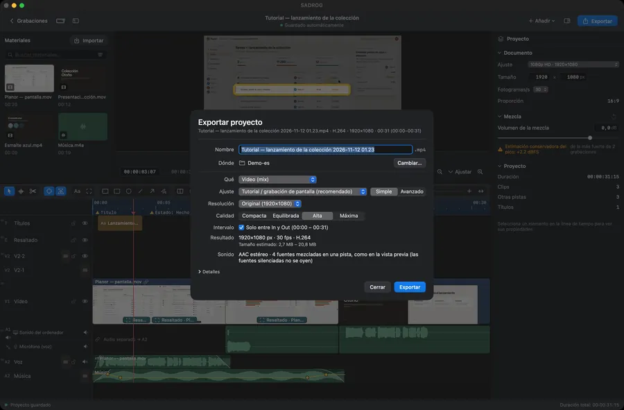

<p align="center">
  <a href="https://gordas.dev/sadrog/es/"></a>
</p>

<h1 align="center">SADROG</h1>

<p align="center">
  <b>Graba la pantalla. Edita. Exporta.</b><br>
  Grabación de pantalla y edición de vídeo para macOS, en una sola aplicación.<br>Pantalla, ventana, cámara y sonido, cada uno en su pista. Software libre.
</p>

<p align="center"><a href="README.md">English</a> &nbsp;·&nbsp; <a href="README.ro.md">Română</a> &nbsp;·&nbsp; <b>Español</b></p>

<p align="center"><a href="https://github.com/gordasgdc/sadrog/releases/latest"></a> <a href="LICENSE"></a>   </p>

<p align="center">
  <a href="https://github.com/gordasgdc/sadrog/releases/latest/download/SADROG.dmg"><b>Descargar para Mac ↓</b></a> &nbsp;·&nbsp;
  <a href="https://gordas.dev/sadrog/es/">Página del producto</a> &nbsp;·&nbsp;
  <a href="https://gordas.dev/sadrog/manual/SADROG-Manual-ES.pdf">Manual de usuario (PDF)</a> &nbsp;·&nbsp;
  <a href="#build">Compilar desde el código</a> &nbsp;·&nbsp;
  <a href="CONTRIBUTING.md">Contribuir</a>
</p>

---

## En resumen

<table>
<tr>
<td width="33%" valign="top"><b>Cada fuente en su pista</b><br><sub>La pantalla, la ventana o la región, la cámara, el sonido del ordenador y el micrófono se graban por separado y siguen separados en el editor.</sub></td>
<td width="33%" valign="top"><b>De la grabación al archivo, en una ventana</b><br><sub>Cortar, recortar, títulos, resaltados, cámara en círculo, color, sonido y exportación. Sin una segunda aplicación.</sub></td>
<td width="33%" valign="top"><b>Nada se degrada en silencio</b><br><sub>Lo que ves en la vista previa es lo que se exporta. Cuando algo no se puede hacer como lo pediste, SADROG se niega y dice por qué.</sub></td>
</tr>
<tr>
<td width="50%" valign="top"><br><b>Cursor</b><br><sub>Contorno, halo o disco alrededor del cursor, con color, tamaño y opacidad; anillos que distinguen el clic izquierdo, el derecho y el doble clic.</sub></td>
<td width="50%" valign="top"><br><b>Títulos</b><br><sub>Títulos con estilo y animación en su propia pista, editados directamente en el visor.</sub></td>
</tr>
</table>

## Un recorrido por la aplicación

<table>
<tr>
<td width="50%" valign="top"><br><b>Nueva grabación</b><br><sub>Una tarjeta por fuente, con nivel y vista previa. Los permisos se piden solo cuando una fuente los necesita.</sub></td>
<td width="50%" valign="top"><br><b>Editor</b><br><sub>Biblioteca, visor, inspector y línea de tiempo multipista en una sola ventana.</sub></td>
</tr>
<tr>
<td width="50%" valign="top"><br><b>Línea de tiempo y sonido</b><br><sub>El sonido del ordenador y el micrófono en filas separadas, con formas de onda, fundidos y puntos de volumen.</sub></td>
<td width="50%" valign="top"><br><b>Resaltados</b><br><sub>Marcos, lupa, flechas y oscurecimiento, unidos al clip exacto que explican.</sub></td>
</tr>
<tr>
<td width="50%" valign="top"><br><b>Color</b><br><sub>Brillo, contraste y saturación para cualquier clip de vídeo; fondo desenfocado o eliminado para la persona grabada.</sub></td>
<td width="50%" valign="top"><br><b>Exportación</b><br><sub>La resolución y la calidad se eligen directamente, MP4 por defecto, con el tamaño estimado antes de empezar.</sub></td>
</tr>
</table>

<sub>Capturas reales de la aplicación (versión 1.7.0). El proyecto mostrado es material de demostración ficticio: la aplicación de planificación, el taller y los nombres son inventados. En la captura Nueva grabación, la fuente de pantalla está simulada.</sub>

## Qué hace

| | |
|---|---|
| **Grabación** | Pantalla, ventana o región; cámara; sonido del ordenador; micrófono e interfaces de audio con elección de canales. Cuenta atrás, pausa, un destino elegido por ti, con el espacio libre a la vista. |
| **Proyecto** | Cada grabación se convierte en un documento de edición con su tamaño y su velocidad de fotogramas. Empiezas con una grabación o con un documento vacío; añades grabaciones a un proyecto abierto. |
| **Edición** | Selección directa, selección rectangular, cortar, recortar, mover, duplicar, arrastrar y soltar, pistas redimensionables y reordenables, deshacer y rehacer, atajos configurables. |
| **Sonido** | Fuentes independientes con formas de onda; puntos de volumen y fundidos editados en la pista; fundido cruzado; el sonido de un clip separado en su propia pieza; preajustes de voz; efectos Audio Unit; un volumen de escucha que no toca la exportación. |
| **Presentación** | Cámara en círculo o en rectángulo, recorte y transformaciones, títulos, resaltados con lupa, flechas, líneas y marcos. |
| **Color y fondo** | Brillo, contraste y saturación por clip; desenfoque o eliminación del fondo detrás de la persona, calculado en el Mac al editar. |
| **Movimiento y estructura** | Marcadores, intervalo In/Out, fotograma congelado, velocidad del clip, animación con claves, transición por disolución; efectos de puntero y de comandos de teclado cuando elegiste grabarlos. |
| **Exportación** | Modo Simple (preajuste, resolución, calidad) y Avanzado (formato MP4 o QuickTime, H.264 o HEVC, calidad constante, tasa media o tamaño objetivo, fotogramas clave, mono o estéreo). Copia sin recodificar cuando el proyecto lo permite, máster ProRes, secuencia de fotogramas sin pérdida con WAV. |
| **Conservar el proyecto** | Archivo con proyecto y medios, con rutas relativas; volver a enlazar archivos que faltan; proyectos recientes. |
| **Idiomas** | Rumano, inglés y español, en la interfaz y en los manuales. |

## Archivos más pequeños para tutoriales

Medido en los mismos 60 segundos de un tutorial de 1920×1080 a 30 fps: el preajuste Tutorial escribió 6,3 MB (0,84 Mb/s, SSIM 0,997), frente a 35,6 MB del mismo material exportado por otro editor a unos 4 Mb/s, con el sonido sincronizado. Cómo se midió y sus límites: <a href="docs/EXPORT_MEASUREMENTS.md">docs/EXPORT_MEASUREMENTS.md</a>.

## Descarga y compatibilidad

| | |
|---|---|
| **Sistema** | macOS 15 o posterior |
| **Mac** | Apple Silicon |
| **Descarga** | <a href="https://github.com/gordasgdc/sadrog/releases/latest/download/SADROG.dmg">SADROG.dmg</a> de la <a href="https://github.com/gordasgdc/sadrog/releases/latest">última versión</a>; arrastra SADROG a Aplicaciones |
| **Firma** | Developer ID, notarizado por Apple |
| **Permisos** | Grabación de pantalla para capturar; Micrófono y Cámara solo cuando añades esas fuentes. El teclado se lee solo si activas los comandos de teclado en pantalla |
| **Actualizaciones** | <i>Buscar actualizaciones…</i> en la aplicación |
| **Proyectos** | Los proyectos guardados por 1.7.0 no se abren en versiones anteriores; los proyectos antiguos se abren sin cambios |

## Uso sin activación, prueba y activación

- Sin activación: abres, editas y guardas proyectos.
- Con activación: nueva grabación y exportación.
- <b>Prueba Full de 5 días</b>, que empieza en la primera activación efectiva, tras la aprobación manual de la solicitud. Una prueba por Mac.
- <b>Activación permanente:</b> las condiciones se muestran en la aplicación.
- La solicitud envía tu nombre y correo (solo para responder), el nombre del ordenador, la opción elegida, el idioma, la versión y el identificador de este Mac. Ninguna grabación, ningún proyecto, ningún archivo.

## Manual de usuario

PDF, en tres idiomas: [Română](https://gordas.dev/sadrog/manual/SADROG-Manual-RO.pdf) · [English](https://gordas.dev/sadrog/manual/SADROG-Manual-EN.pdf) · [Español](https://gordas.dev/sadrog/manual/SADROG-Manual-ES.pdf)

<a name="build"></a>
## Compilar desde el código

Requisitos: macOS 15+, herramientas de línea de comandos de Xcode 16+ (Swift 6), Apple Silicon.

```
swift build -c release
swift test
SADROG_BUILD_DIR=$HOME/sadrog-build scripts/build_app.sh "<codesign identity>"
```

Las pruebas que necesitan medios no distribuidos con el repositorio se omiten automáticamente. Una compilación propia se puede firmar ad hoc (<code>-</code>) para uso personal; las versiones oficiales usan Developer ID. La activación se comunica con el servicio del autor. Detalles: <a href="docs/BUILDING.md">docs/BUILDING.md</a>.

## Contribuciones y soporte

- Problemas e ideas: <a href="https://github.com/gordasgdc/sadrog/issues">Issues</a>. El registro de diagnóstico está en <code>~/Library/Logs/SADROG.log</code> (sin contraseñas ni contenido de archivos).
- Las pull requests son bienvenidas; lee antes <a href="CONTRIBUTING.md">CONTRIBUTING.md</a> (en inglés). Los colaboradores figuran en <a href="CONTRIBUTORS.md">CONTRIBUTORS.md</a>.
- Qué cambió en cada versión: <a href="CHANGELOG.md">CHANGELOG.md</a>.

## Límites actuales

- Solo Apple Silicon y macOS 15 o posterior.
- Los efectos de puntero, de comandos de teclado y de ventana activa funcionan solo si la opción estaba activada antes de grabar; no se pueden deducir después.
- El fondo de la persona se calcula al exportar y lo hace más lento.
- No hay codificación en varias pasadas; el tamaño objetivo es una estimación.
- Los efectos Audio Unit dependen de los plug-ins instalados en tu Mac.

## Licencia

GPL-3.0-or-later: <a href="LICENSE">LICENSE</a>, <a href="COPYING-NOTICE.md">COPYING-NOTICE.md</a>. Componentes y atribuciones: <a href="docs/PROVENANCE.md">docs/PROVENANCE.md</a>. Iniciador y autor: Dumitru Cristinel Gordas.
