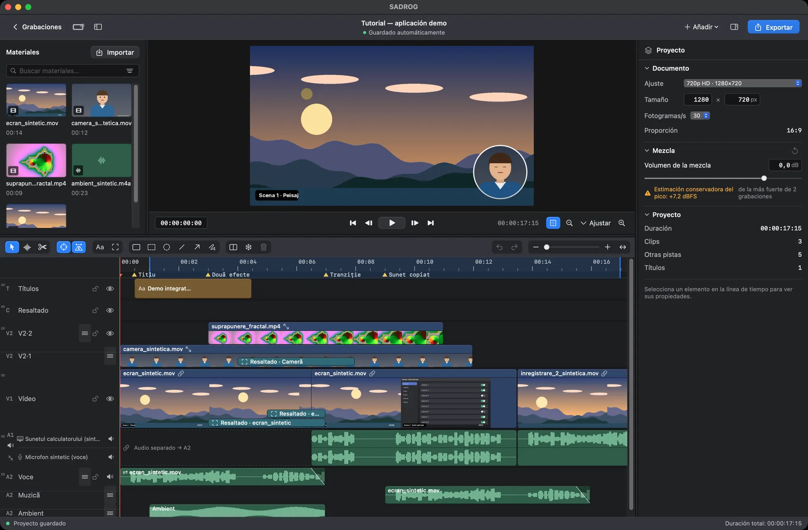
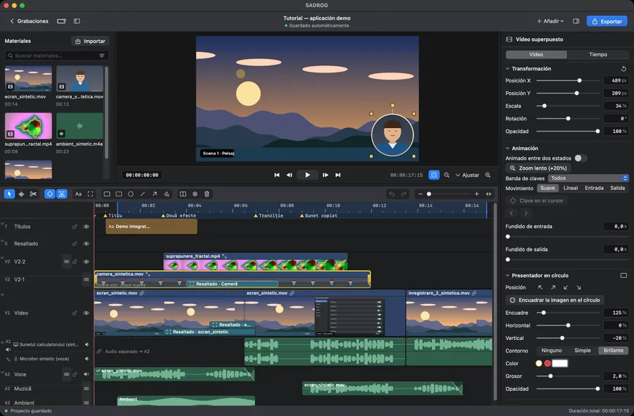
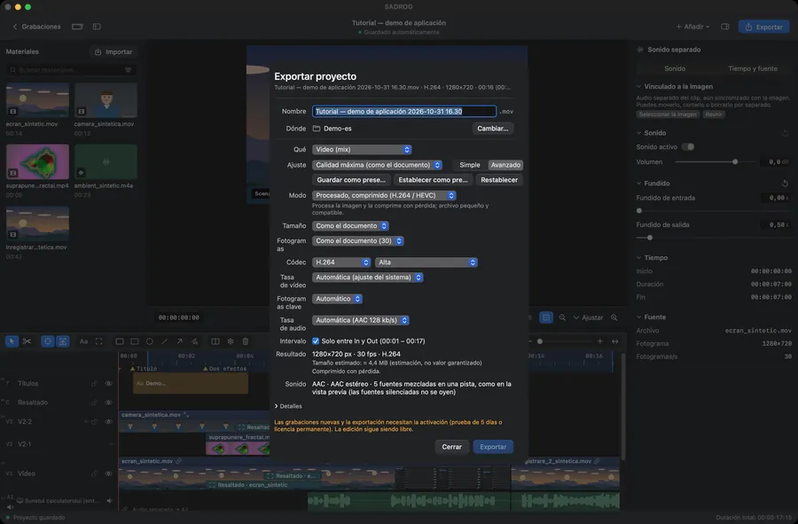
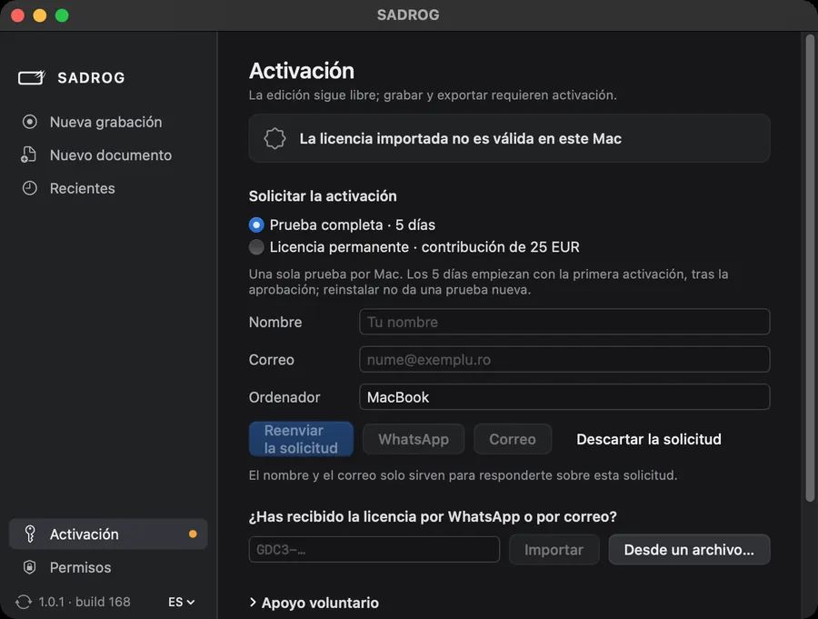

[English](README.md) · [Română](README.ro.md) · **Español**

# SADROG

**Grabación y edición de vídeo para Mac, en una sola aplicación.**

SADROG graba la pantalla, una ventana, la cámara y el sonido en macOS, y luego lo editas en una línea de tiempo con pistas: cortas, ajustas, añades títulos y resaltados y exportas. Es software libre (GPL-3.0-or-later) de Dumitru Cristinel Gordas.

[Página del producto](https://gordas.dev/sadrog/es/) · [Última versión](https://github.com/gordasgdc/sadrog/releases/latest) · [Descargar (DMG)](https://github.com/gordasgdc/sadrog/releases/latest/download/SADROG.dmg) · [Manual (PDF)](https://gordas.dev/sadrog/manual/SADROG-Manual-ES.pdf) · [Incidencias](https://github.com/gordasgdc/sadrog/issues)


*El editor con un proyecto de demostración sintético (captura real de la versión publicada).*

## Para quién es

- Tutoriales con pantalla y cámara, con la cámara en un círculo sobre la pantalla.
- Demostraciones de aplicaciones, con marcos y flechas en el clip exacto al que se refieren.
- Presentaciones con voz en off: el micrófono queda en su propia pista.
- Montaje de varias grabaciones añadidas al mismo proyecto.

## Funciones principales

- **Grabación.** Monitor, ventana o región; cámara; sonido del ordenador; micrófono. Cada fuente se graba por separado y llega a su pista. Los permisos de macOS se piden solo al añadir una fuente que los necesite.
- **Proyecto.** Cada grabación se convierte en un documento de edición (tamaño y velocidad de fotogramas a tu elección). También puedes empezar un documento vacío o añadir grabaciones a un proyecto abierto.
- **Edición.** Visor y línea de tiempo con selección directa, inspector contextual, corte, recorte, mover, duplicar, arrastrar y soltar, pistas redimensionables y reordenables, deshacer/rehacer.
- **Sonido.** Fuentes independientes con formas de onda, niveles, silencio, fundidos; el audio de un clip se puede separar en una pieza propia.
- **Presentación.** Cámara superpuesta (presentador en círculo), recorte y transformaciones, títulos con estilos de texto, resaltados, flechas, líneas y marcos adjuntos a un clip concreto.
- **Movimiento y estructura.** Marcadores, intervalo In/Out, congelar fotograma, animación por claves, fundido encadenado. Los efectos de cursor y ventana en primer plano requieren metadatos grabados durante la captura (opcionales, desactivados por defecto).
- **Exportación.** Modo simple con preajustes o Avanzado: tamaño (incluido 4K), velocidad de fotogramas, H.264/HEVC, calidad, tasas; copia sin recodificar cuando el proyecto no requiere procesamiento (si no, se rechaza, nunca se degrada en silencio); ProRes máster; secuencia de fotogramas sin pérdida + WAV.
- **Conservar el proyecto.** Archivo proyecto + medios con rutas relativas; revincular archivos ausentes.


*Preparación de la grabación. La fuente de pantalla es simulada en esta captura.*


*Clip de la cámara seleccionado: transformación y presentador en círculo.*


*Línea de tiempo con fuentes de audio separadas y formas de onda.*


*Exportación avanzada.*

## Requisitos, descarga e instalación

- macOS 15 o posterior, Mac con Apple Silicon.
- Descarga `SADROG.dmg` de la [última versión](https://github.com/gordasgdc/sadrog/releases/latest); arrastra SADROG a Aplicaciones. La distribución está firmada con Developer ID y notarizada por Apple.
- Permisos (se piden en contexto): Grabación de pantalla para capturar; Micrófono y Cámara solo al añadir esas fuentes. No se lee el teclado.
- Actualizaciones: *Buscar actualizaciones…* en la aplicación.

## Uso sin activación, prueba y activación

- Sin activación: abres, editas y guardas proyectos.
- Con activación: grabación nueva y exportación.
- **Prueba Full de 5 días**, desde la primera activación efectiva, tras la aprobación manual de la solicitud. Una prueba por Mac.
- **Activación permanente** tras una contribución de 25 EUR, verificada por el desarrollador: sin suscripción, un Mac, funciona sin conexión una vez activada.
- La solicitud envía tu nombre y correo (solo para responder), el nombre del ordenador, la opción elegida, el idioma, la versión y el identificador de este Mac; no envía grabaciones, proyectos ni archivos.


*Página Activación (campos de nombre y correo vacíos).*

## Manual de usuario

[Română](https://gordas.dev/sadrog/manual/SADROG-Manual-RO.pdf) · [English](https://gordas.dev/sadrog/manual/SADROG-Manual-EN.pdf) · [Español](https://gordas.dev/sadrog/manual/SADROG-Manual-ES.pdf) (PDF, documentación 1.0)

## Compilar desde el código

Requisitos: macOS 15+, herramientas de línea de comandos de Xcode 16+ (Swift 6), Apple Silicon.

```
swift build -c release
swift test
SADROG_BUILD_DIR=$HOME/sadrog-build scripts/build_app.sh "<codesign identity>"
```

`SADROG_TEST_ROOT` fija la carpeta de trabajo de las pruebas (por defecto: una carpeta en el directorio temporal del sistema). Las pruebas que requieren datos privados o externos se omiten. Una compilación propia se puede firmar ad hoc (`-`) para uso personal; las versiones oficiales usan Developer ID. La activación se comunica con el servicio del autor. Véase [docs/BUILDING.md](docs/BUILDING.md).

## Soporte, contribuciones, licencia

- Informa de problemas e ideas en [Issues](https://github.com/gordasgdc/sadrog/issues). Registro de diagnóstico: `~/Library/Logs/SADROG.log` (sin contraseñas ni contenido de archivos).
- Las contribuciones son bienvenidas mediante pull request; los colaboradores figuran en [CONTRIBUTORS.md](CONTRIBUTORS.md).
- Licencia: GPL-3.0-or-later ([LICENSE](LICENSE), [COPYING-NOTICE.md](COPYING-NOTICE.md)); componentes y atribuciones en [docs/PROVENANCE.md](docs/PROVENANCE.md).

## Límites de la versión 1.0

- Solo Apple Silicon y macOS 15+.
- Los efectos de cursor y ventana en primer plano solo funcionan si la opción se activó antes de la captura; no se pueden deducir después.
- La disponibilidad de plugins Audio Unit depende de los plugins instalados en tu Mac.
- Las funciones no listadas aquí no forman parte de esta versión.
