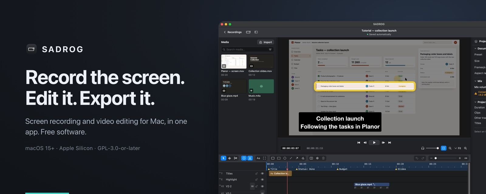
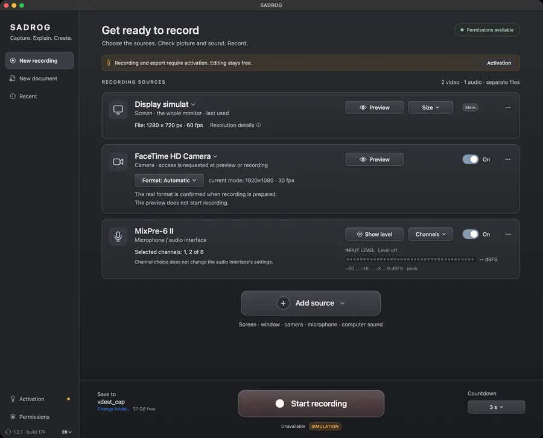
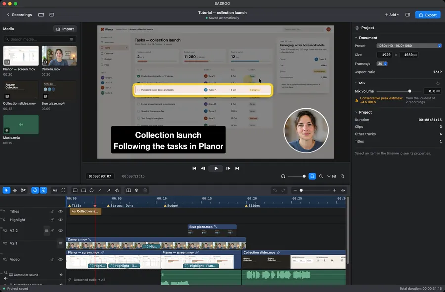
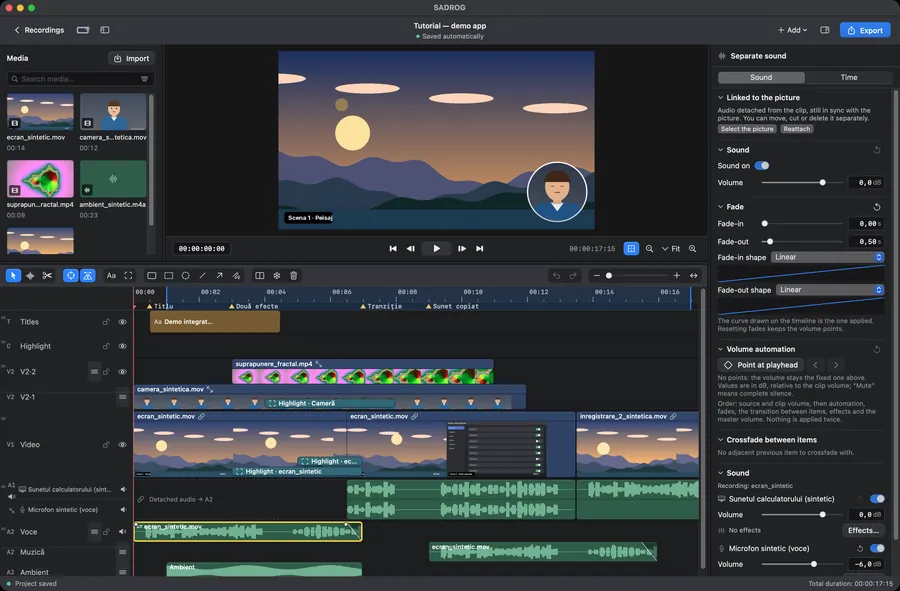
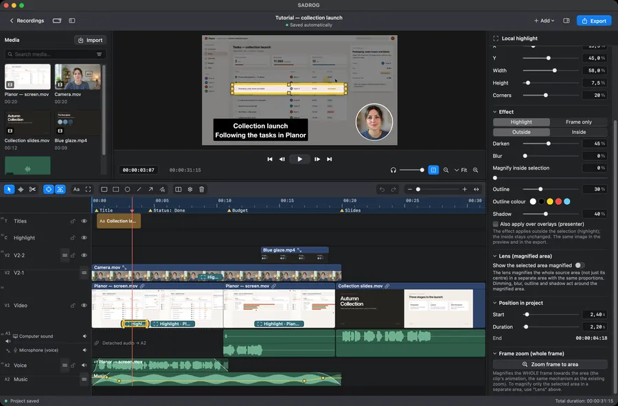
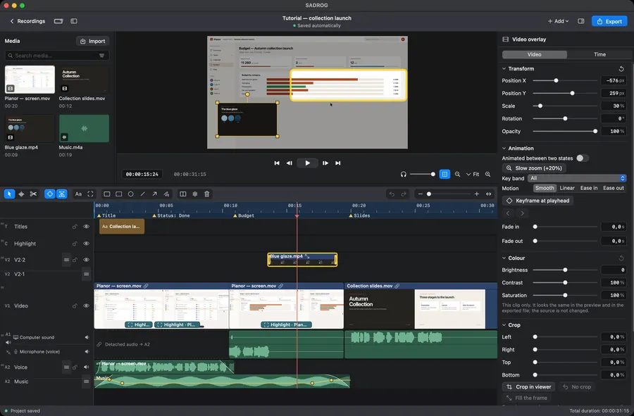
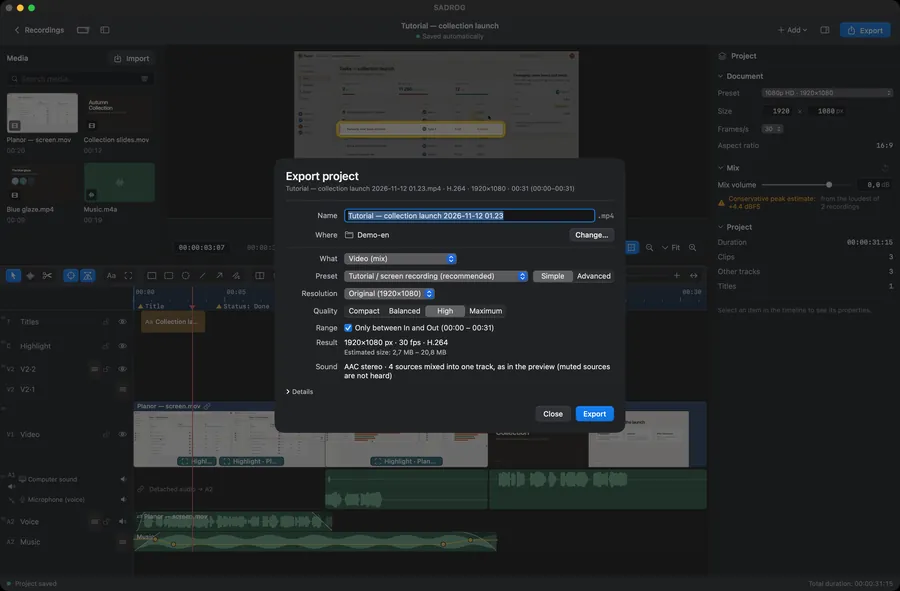

<p align="center">
  <a href="https://gordas.dev/sadrog/en/"></a>
</p>

<h1 align="center">SADROG</h1>

<p align="center">
  <b>Record the screen. Edit it. Export it.</b><br>
  Screen recording and video editing for macOS, in one app.<br>Screen, window, camera and sound, each on its own track. Free software.
</p>

<p align="center"><b>English</b> &nbsp;·&nbsp; <a href="README.ro.md">Română</a> &nbsp;·&nbsp; <a href="README.es.md">Español</a></p>

<p align="center"><a href="https://github.com/gordasgdc/sadrog/releases/latest"></a> <a href="LICENSE"></a>   </p>

<p align="center">
  <a href="https://github.com/gordasgdc/sadrog/releases/latest/download/SADROG.dmg"><b>Download for Mac ↓</b></a> &nbsp;·&nbsp;
  <a href="https://gordas.dev/sadrog/en/">Product page</a> &nbsp;·&nbsp;
  <a href="https://gordas.dev/sadrog/manual/SADROG-Manual-EN.pdf">User manual (PDF)</a> &nbsp;·&nbsp;
  <a href="#build">Build from source</a> &nbsp;·&nbsp;
  <a href="CONTRIBUTING.md">Contribute</a>
</p>

---

## At a glance

<table>
<tr>
<td width="33%" valign="top"><b>Every source on its own track</b><br><sub>Screen, window or region, camera, computer sound and microphone are recorded separately and stay separate in the editor.</sub></td>
<td width="33%" valign="top"><b>From recording to file, in one window</b><br><sub>Cut, trim, titles, highlights, camera in a circle, colour, sound, then export. No second application.</sub></td>
<td width="33%" valign="top"><b>Nothing degrades silently</b><br><sub>The preview is what gets exported. When something cannot be done as asked, SADROG refuses and says why.</sub></td>
</tr>
</table>

## A tour of the app

<table>
<tr>
<td width="50%" valign="top"><br><b>New recording</b><br><sub>One card per source, with level and preview. Permissions are asked only when a source needs them.</sub></td>
<td width="50%" valign="top"><br><b>Editor</b><br><sub>Library, viewer, inspector and a multi-track timeline in one window.</sub></td>
</tr>
<tr>
<td width="50%" valign="top"><br><b>Timeline and sound</b><br><sub>Computer sound and microphone as separate rows with waveforms, fades and volume points.</sub></td>
<td width="50%" valign="top"><br><b>Highlights</b><br><sub>Frames, magnifier, arrows and dimming attached to the exact clip they explain.</sub></td>
</tr>
<tr>
<td width="50%" valign="top"><br><b>Colour</b><br><sub>Brightness, contrast and saturation for any video clip; blurred or removed background for a person on camera.</sub></td>
<td width="50%" valign="top"><br><b>Export</b><br><sub>Resolution and quality chosen directly, MP4 by default, with a size estimate before you start.</sub></td>
</tr>
</table>

<sub>Real captures of the application (version 1.7.0). The project shown is fictional demonstration material: the planning app, the studio and the names in it are invented. In the New recording capture the screen source is simulated.</sub>

## What it does

| | |
|---|---|
| **Recording** | Display, window or region; camera; computer sound; microphone and audio interfaces with channel choice. Countdown, pause, a destination you choose, with free space shown. |
| **Project** | Every recording becomes an editing document with its own size and frame rate. Start from a recording or from an empty document; add recordings to an open project. |
| **Editing** | Direct selection, rectangle selection, cut, trim, move, duplicate, drag and drop, resizable and reorderable tracks, undo and redo, customizable shortcuts. |
| **Sound** | Independent sources with waveforms; volume points and fades edited on the track; crossfade; detach a clip’s sound; voice presets; Audio Unit effects; a listening volume that never touches the export. |
| **Presentation** | Camera in a circle or a rectangle, crop and transforms, titles, highlights with a magnifier, arrows, lines and frames. |
| **Colour and background** | Brightness, contrast and saturation per clip; blur or remove the background behind a person, computed on the Mac while editing. |
| **Motion and structure** | Markers, In/Out range, freeze frame, clip speed, keyframe animation, cross-dissolve; pointer and key-command effects when you chose to record them. |
| **Export** | Simple mode (preset, resolution, quality) and Advanced (format MP4 or QuickTime, H.264 or HEVC, constant quality, average rate or target size, key frames, mono or stereo). Copy without re-encoding when the project allows it, ProRes master, lossless frame sequence with WAV. |
| **Keeping the project** | Archive project and media with relative paths; relink missing files; recent projects. |
| **Languages** | Romanian, English, Spanish, in the interface and in the manuals. |

## Smaller files for tutorials

Measured on the same 60 seconds of a 1920×1080, 30 fps tutorial: the Tutorial preset wrote 6.3 MB (0.84 Mb/s, SSIM 0.997) against 35.6 MB for the same material exported by another editor at about 4 Mb/s, with sound in sync. How it was measured and its limits: <a href="docs/EXPORT_MEASUREMENTS.md">docs/EXPORT_MEASUREMENTS.md</a>.

## Download and compatibility

| | |
|---|---|
| **System** | macOS 15 or newer |
| **Mac** | Apple Silicon |
| **Download** | <a href="https://github.com/gordasgdc/sadrog/releases/latest/download/SADROG.dmg">SADROG.dmg</a> from the <a href="https://github.com/gordasgdc/sadrog/releases/latest">latest release</a>; drag SADROG to Applications |
| **Signature** | Developer ID, notarized by Apple |
| **Permissions** | Screen Recording to capture; Microphone and Camera only when you add those sources. The keyboard is read only if you switch on key commands on screen |
| **Updates** | <i>Check for updates…</i> in the app |
| **Projects** | Projects saved by 1.7.0 do not open in older versions; older projects open unchanged |

## Use without activation, trial and activation

- Without activation: open, edit and save projects.
- With activation: new recording and export.
- <b>5-day Full trial</b>, starting at the first actual activation, after the request is approved by hand. One trial per Mac.
- <b>Permanent activation:</b> the conditions are shown in the app.
- The request sends your name and e-mail (only to reply), the computer name, the chosen option, language, version and this Mac’s identifier. No recordings, projects or files.

## User manual

PDF, in three languages: [Română](https://gordas.dev/sadrog/manual/SADROG-Manual-RO.pdf) · [English](https://gordas.dev/sadrog/manual/SADROG-Manual-EN.pdf) · [Español](https://gordas.dev/sadrog/manual/SADROG-Manual-ES.pdf)

<a name="build"></a>
## Build from source

Requirements: macOS 15+, Xcode 16+ command line tools (Swift 6), Apple Silicon.

```
swift build -c release
swift test
SADROG_BUILD_DIR=$HOME/sadrog-build scripts/build_app.sh "<codesign identity>"
```

Tests that need media not distributed with the repository are skipped automatically. A build from source can be signed ad hoc (<code>-</code>) for your own use; official releases use a Developer ID. Activation talks to the author’s service. Details: <a href="docs/BUILDING.md">docs/BUILDING.md</a>.

## Contributing and support

- Problems and ideas: <a href="https://github.com/gordasgdc/sadrog/issues">Issues</a>. The diagnostic log is at <code>~/Library/Logs/SADROG.log</code> (no passwords, no file contents).
- Pull requests are welcome; read <a href="CONTRIBUTING.md">CONTRIBUTING.md</a> first. Contributors are credited in <a href="CONTRIBUTORS.md">CONTRIBUTORS.md</a>.
- What changed in each version: <a href="CHANGELOG.md">CHANGELOG.md</a>.

## Current limits

- Apple Silicon and macOS 15 or newer only.
- Pointer, key-command and foreground-window effects work only when the option was on before the recording; they cannot be derived afterwards.
- The person’s background is computed at export and makes it slower.
- There is no multi-pass encoding; a target size is an estimate.
- Audio Unit effects depend on the plug-ins installed on your Mac.

## Licence

GPL-3.0-or-later: <a href="LICENSE">LICENSE</a>, <a href="COPYING-NOTICE.md">COPYING-NOTICE.md</a>. Components and attributions: <a href="docs/PROVENANCE.md">docs/PROVENANCE.md</a>. Initiator and author: Dumitru Cristinel Gordas.
