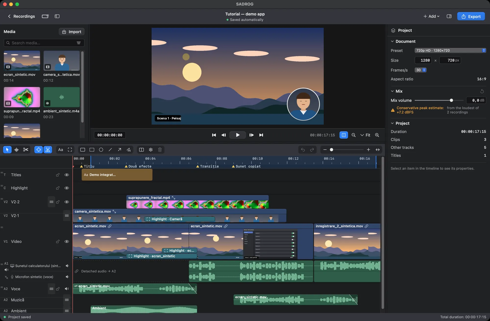
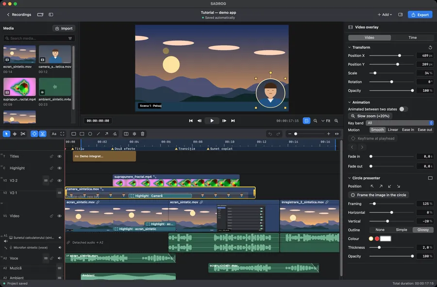
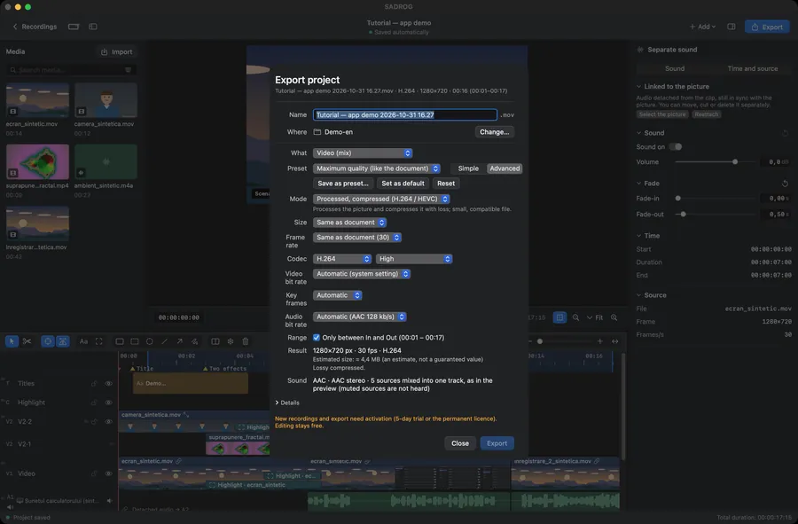
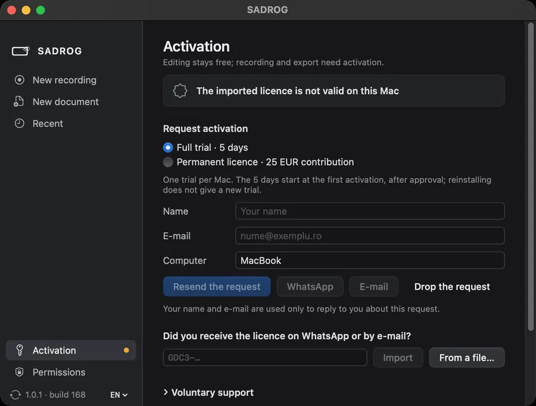

**English** · [Română](README.ro.md) · [Español](README.es.md)

# SADROG

**Screen recording and video editing for Mac, in one app.**

SADROG records your screen, a window, your camera and sound on macOS, then lets you edit everything on a multi-track timeline: cut, trim, add titles and highlights, and export. It is free software (GPL-3.0-or-later) by Dumitru Cristinel Gordas.

[Product page](https://gordas.dev/sadrog/) · [Latest release](https://github.com/gordasgdc/sadrog/releases/latest) · [Download (DMG)](https://github.com/gordasgdc/sadrog/releases/latest/download/SADROG.dmg) · [User manual (PDF)](https://gordas.dev/sadrog/manual/SADROG-Manual-EN.pdf) · [Issues](https://github.com/gordasgdc/sadrog/issues)


*The editor with a synthetic demo project (real screenshot of the released version).*

## Who it is for

- Screen + camera tutorials, with your camera in a circle over the screen.
- App demos with frames and arrows on the exact clip they refer to.
- Presentations with voice-over: the microphone stays on its own track.
- Montage from several recordings added to the same project.

## Main features

- **Recording.** Display, window or region; camera; computer sound; microphone. Each source is recorded separately and lands on its own track. macOS permissions are requested only when you add a source that needs them.
- **Project.** Every recording becomes an editing document (size and frame rate of your choice). You can also start an empty document or add recordings to an open project.
- **Editing.** Viewer and timeline with direct selection, a contextual inspector, cut, trim, move, duplicate, drag-and-drop, resizable and reorderable tracks, undo/redo.
- **Sound.** Independent sources with waveforms, levels, mute, fades; detach a clip’s audio into its own piece.
- **Presentation.** Camera overlay (circular presenter), crop and transforms, titles with text styles, highlights, arrows, lines and frames attached to a specific clip.
- **Motion and structure.** Markers, In/Out range, freeze frame, keyframe animation, cross-dissolve. Cursor and foreground-window effects need metadata recorded during capture (optional, off by default).
- **Export.** Simple mode with presets, or Advanced: size (including 4K), frame rate, H.264/HEVC, quality, rates; copy without re-encoding when the project needs no processing (otherwise refused, never silently degraded); ProRes master; lossless frame sequence + WAV.
- **Keep the project.** Archive project + media with relative paths; relink missing files.


*Recording preparation. The screen source is simulated in this capture.*


*Camera clip selected: transform and circular presenter.*


*Timeline with separate audio sources and waveforms.*


*Advanced export.*

## Requirements, download and install

- macOS 15 or newer, Mac with Apple Silicon.
- Download `SADROG.dmg` from the [latest release](https://github.com/gordasgdc/sadrog/releases/latest); drag SADROG to Applications. The build is signed with Developer ID and notarized by Apple.
- Permissions (asked in context): Screen Recording to capture; Microphone and Camera only when you add those sources. The keyboard is not read.
- Updates: *Check for updates…* in the app.

## Use without activation, trial and activation

- Without activation: open, edit and save projects.
- With activation: new recording and export.
- **5-day Full trial**, starting at the first actual activation, after manual approval of the request. One trial per Mac.
- **Permanent activation** after a 25 EUR contribution, checked by the developer: no subscription, one Mac, works offline once activated.
- The request sends your name and e-mail (only to reply), computer name, chosen option, language, version and this Mac’s identifier — no recordings, projects or files.


*Activation page (name and e-mail fields empty).*

## User manual

[Română](https://gordas.dev/sadrog/manual/SADROG-Manual-RO.pdf) · [English](https://gordas.dev/sadrog/manual/SADROG-Manual-EN.pdf) · [Español](https://gordas.dev/sadrog/manual/SADROG-Manual-ES.pdf) (PDF, documentation 1.0)

## Build from source

Requirements: macOS 15+, Xcode 16+ command line tools (Swift 6), Apple Silicon.

```
swift build -c release
swift test
SADROG_BUILD_DIR=$HOME/sadrog-build scripts/build_app.sh "<codesign identity>"
```

`SADROG_TEST_ROOT` sets the scratch folder used by tests (default: a folder in the system temporary directory). Tests that need private or external data are skipped. A build from source can be signed ad hoc (`-`) for your own use; official releases use a Developer ID. Activation talks to the author’s service. See [docs/BUILDING.md](docs/BUILDING.md).

## Support, contributions, license

- Report problems and ideas in [Issues](https://github.com/gordasgdc/sadrog/issues). Diagnostic log: `~/Library/Logs/SADROG.log` (no passwords or file contents).
- Contributions are welcome through pull requests; contributors are credited in [CONTRIBUTORS.md](CONTRIBUTORS.md).
- License: GPL-3.0-or-later ([LICENSE](LICENSE), [COPYING-NOTICE.md](COPYING-NOTICE.md)); components and attributions in [docs/PROVENANCE.md](docs/PROVENANCE.md).

## Limits of version 1.0

- Apple Silicon and macOS 15+ only.
- Cursor and foreground-window effects work only when the option was enabled before capture; they cannot be derived afterwards.
- Audio Unit plug-in availability depends on the plug-ins installed on your Mac.
- Features not listed here are not part of this version.
