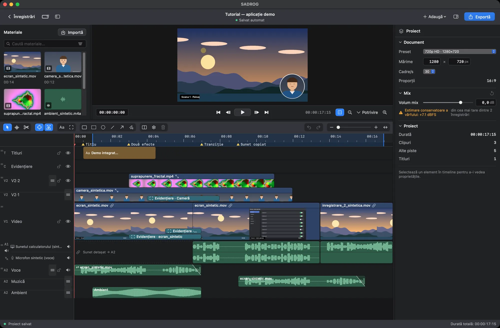
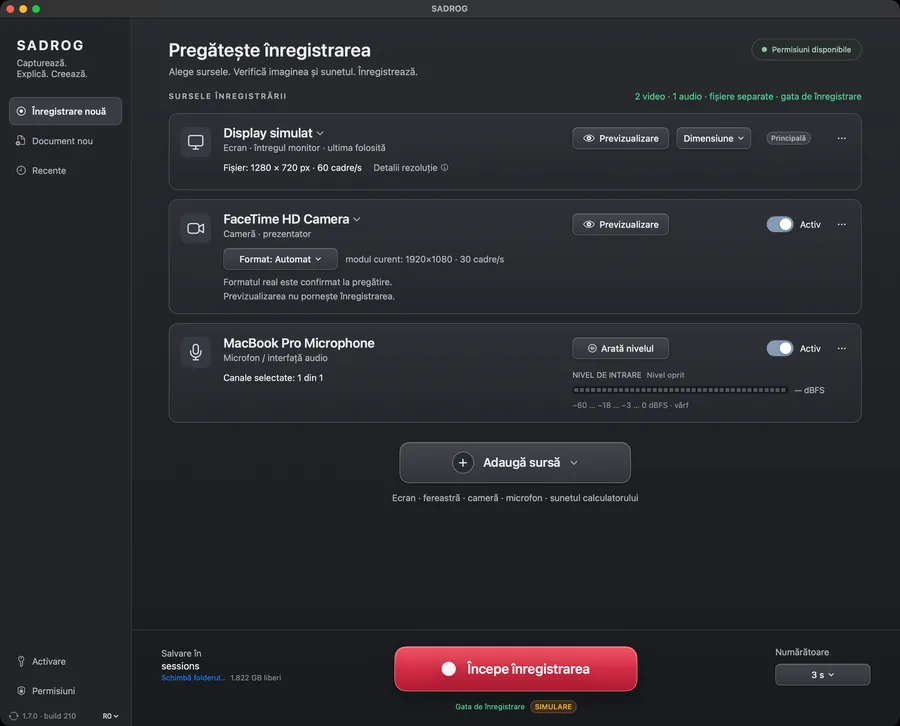
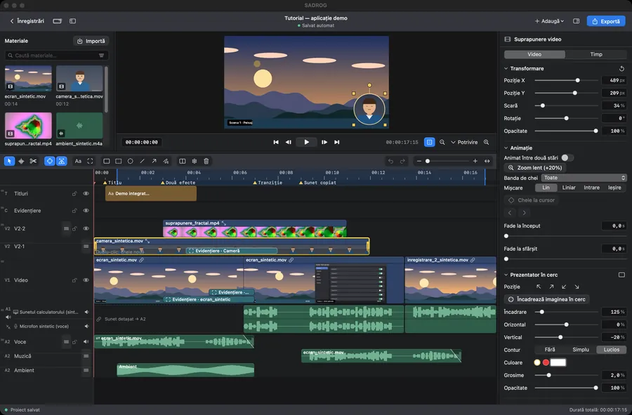
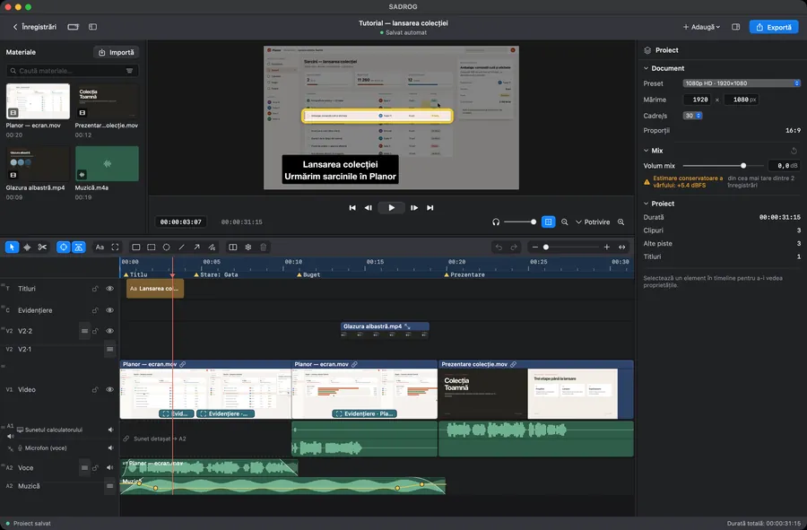
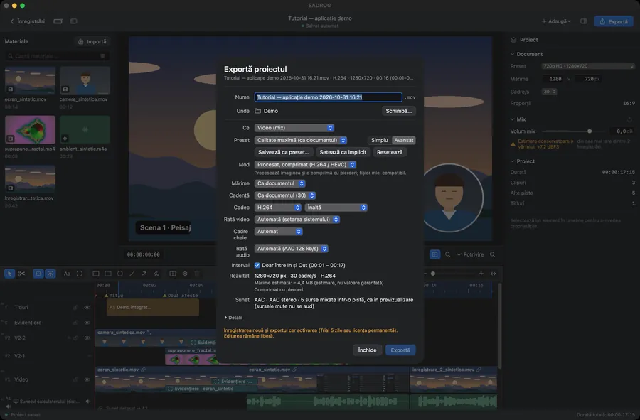
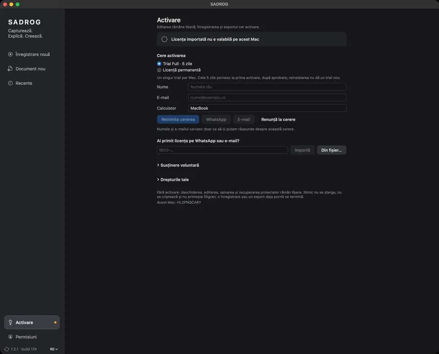

[English](README.md) · **Română** · [Español](README.es.md)

# SADROG

**Înregistrare și montaj video pentru Mac, într-o singură aplicație.**

SADROG înregistrează ecranul, o fereastră, camera și sunetul pe macOS, apoi le montezi pe un timeline cu piste: tai, ajustezi, adaugi titluri și evidențieri și exporți. Este software liber (GPL-3.0-or-later), creat de Dumitru Cristinel Gordas.

[Pagina produsului](https://gordas.dev/sadrog/) · [Ultima versiune](https://github.com/gordasgdc/sadrog/releases/latest) · [Descarcă (DMG)](https://github.com/gordasgdc/sadrog/releases/latest/download/SADROG.dmg) · [Manual (PDF)](https://gordas.dev/sadrog/manual/SADROG-Manual-RO.pdf) · [Probleme](https://github.com/gordasgdc/sadrog/issues)


*Editorul cu un proiect demonstrativ sintetic (captură reală a versiunii publicate).*

## Pentru cine este

- Tutoriale cu ecran și cameră, cu camera într-un cerc peste ecran.
- Demonstrații de aplicații, cu cadre și săgeți pe clipul exact la care se referă.
- Prezentări cu explicație vocală: microfonul rămâne pe pista lui.
- Montaj din mai multe înregistrări adăugate în același proiect.

## Funcții principale

- **Înregistrare.** Monitor, fereastră sau regiune; cameră; sunetul calculatorului; microfon. Fiecare sursă se înregistrează separat și ajunge pe pista ei. Permisiunile macOS se cer doar când adaugi o sursă care le cere.
- **Proiect.** Fiecare înregistrare devine un document de montaj (dimensiune și cadență la alegere). Poți porni și un document gol sau poți adăuga înregistrări într-un proiect deschis.
- **Editare.** Viewer și timeline cu selecție directă, inspector contextual, tăiere, trim, mutare, duplicare, drag-and-drop, piste redimensionabile și reordonabile, undo/redo.
- **Sunet.** Surse independente cu forme de undă, nivele, mute, fade-uri; sunetul unui clip se poate desprinde într-o piesă proprie.
- **Prezentare.** Camera suprapusă (prezentator în cerc), crop și transformări, titluri cu stiluri de text, evidențieri, săgeți, linii și cadre atașate unui clip anume.
- **Mișcare și structură.** Marcaje, interval In/Out, înghețare cadru, animații pe chei, dizolvare încrucișată. Efectele de cursor și fereastră din prim-plan cer metadate înregistrate în timpul capturii (opționale, oprite implicit).
- **Export.** Mod simplu cu presetări sau Avansat: dimensiune (inclusiv 4K), cadență, H.264/HEVC, calitate, rate; copiere fără recodare când proiectul nu cere procesare (altfel refuzată, niciodată degradată pe tăcute); ProRes master; secvență de cadre fără pierderi + WAV.
- **Păstrarea proiectului.** Arhivă proiect + media cu căi relative; relegare pentru fișierele lipsă.


*Pregătirea înregistrării. Sursa de ecran este simulată în această captură.*


*Clipul camerei selectat: transformare și prezentator în cerc.*


*Timeline cu surse audio separate și forme de undă.*


*Export avansat.*

## Cerințe, descărcare și instalare

- macOS 15 sau mai nou, Mac cu Apple Silicon.
- Descarcă `SADROG.dmg` din [ultima versiune](https://github.com/gordasgdc/sadrog/releases/latest); trage SADROG în Applications. Distribuția este semnată cu Developer ID și notarizată de Apple.
- Permisiuni (cerute în context): Înregistrare ecran pentru captură; Microfon și Cameră doar când adaugi acele surse. Tastatura nu se citește.
- Actualizări: *Caută actualizări…* în aplicație.

## Utilizare fără activare, trial și activare

- Fără activare: deschizi, editezi și salvezi proiecte.
- Cu activare: înregistrare nouă și export.
- **Trial Full de 5 zile**, pornit la prima activare efectivă, după aprobarea manuală a cererii. Un singur trial pe Mac.
- **Activare permanentă** după o contribuție de 25 EUR, verificată de dezvoltator: fără abonament, un Mac, funcționează offline după activare.
- Cererea trimite numele și e-mailul (doar pentru răspuns), numele calculatorului, opțiunea aleasă, limba, versiunea și identificatorul acestui Mac — nu trimite înregistrări, proiecte sau fișiere.


*Pagina Activare (câmpurile nume și e-mail sunt goale).*

## Manual de utilizare

[Română](https://gordas.dev/sadrog/manual/SADROG-Manual-RO.pdf) · [English](https://gordas.dev/sadrog/manual/SADROG-Manual-EN.pdf) · [Español](https://gordas.dev/sadrog/manual/SADROG-Manual-ES.pdf) (PDF, documentația 1.0)

## Build din surse

Cerințe: macOS 15+, Xcode 16+ command line tools (Swift 6), Apple Silicon.

```
swift build -c release
swift test
SADROG_BUILD_DIR=$HOME/sadrog-build scripts/build_app.sh "<codesign identity>"
```

`SADROG_TEST_ROOT` stabilește folderul de lucru al testelor (implicit: un folder în directorul temporar al sistemului). Testele care cer date private sau externe sunt sărite. Un build din surse poate fi semnat ad hoc (`-`) pentru uz propriu; versiunile oficiale folosesc Developer ID. Activarea comunică cu serviciul autorului. Vezi [docs/BUILDING.md](docs/BUILDING.md).

## Suport, contribuții, licență

- Raportează probleme și idei în [Issues](https://github.com/gordasgdc/sadrog/issues). Jurnal de diagnostic: `~/Library/Logs/SADROG.log` (fără parole sau conținutul fișierelor).
- Contribuțiile sunt binevenite prin pull request; contribuitorii sunt menționați în [CONTRIBUTORS.md](CONTRIBUTORS.md).
- Licență: GPL-3.0-or-later ([LICENSE](LICENSE), [COPYING-NOTICE.md](COPYING-NOTICE.md)); componente și atribuiri în [docs/PROVENANCE.md](docs/PROVENANCE.md).

## Limitele versiunii 1.0

- Doar Apple Silicon și macOS 15+.
- Efectele de cursor și fereastră din prim-plan funcționează doar dacă opțiunea a fost activată înainte de captură; nu pot fi deduse ulterior.
- Disponibilitatea pluginurilor Audio Unit depinde de pluginurile instalate pe Mac-ul tău.
- Funcțiile care nu sunt listate aici nu fac parte din această versiune.
