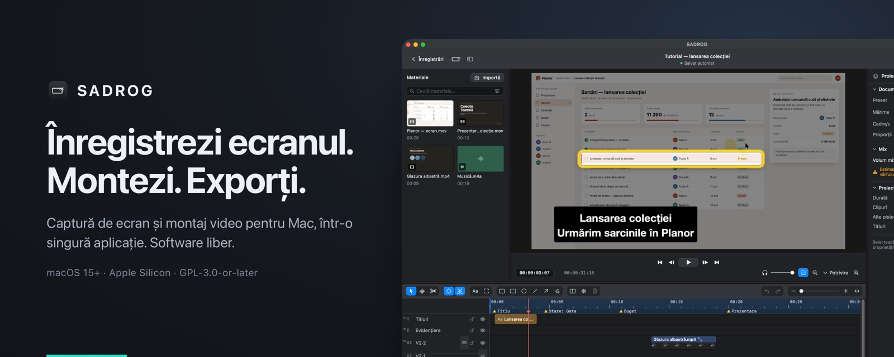
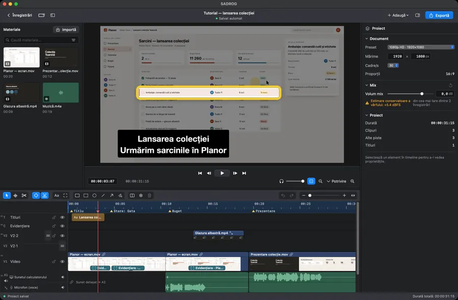
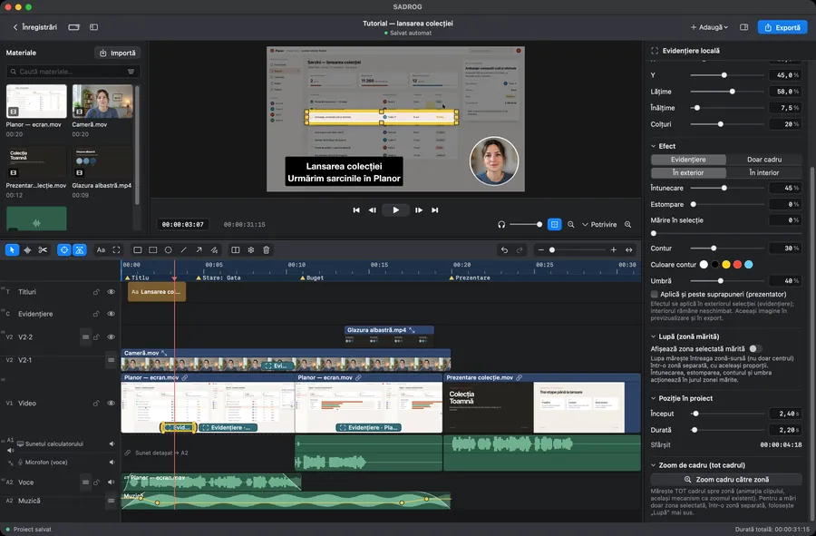
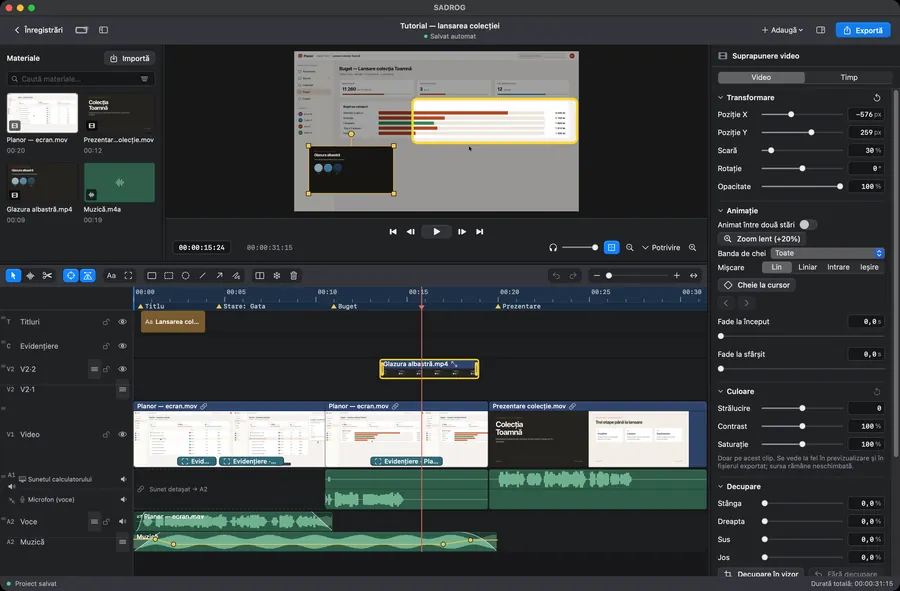
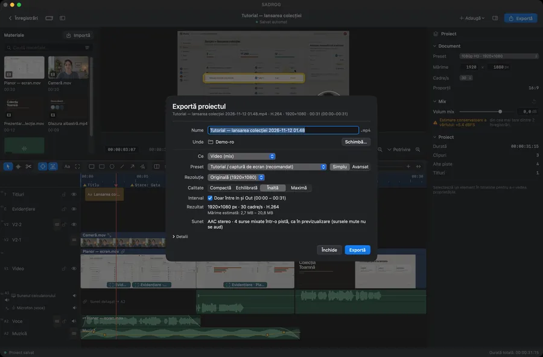

<p align="center">
  <a href="https://gordas.dev/sadrog/"></a>
</p>

<h1 align="center">SADROG</h1>

<p align="center">
  <b>Înregistrezi ecranul. Montezi. Exporți.</b><br>
  Captură de ecran și montaj video pentru macOS, într-o singură aplicație.<br>Ecran, fereastră, cameră și sunet, fiecare pe pista lui. Software liber.
</p>

<p align="center"><a href="README.md">English</a> &nbsp;·&nbsp; <b>Română</b> &nbsp;·&nbsp; <a href="README.es.md">Español</a></p>

<p align="center"><a href="https://github.com/gordasgdc/sadrog/releases/latest"></a> <a href="LICENSE"></a>   </p>

<p align="center">
  <a href="https://github.com/gordasgdc/sadrog/releases/latest/download/SADROG.dmg"><b>Descarcă pentru Mac ↓</b></a> &nbsp;·&nbsp;
  <a href="https://gordas.dev/sadrog/">Pagina produsului</a> &nbsp;·&nbsp;
  <a href="https://gordas.dev/sadrog/manual/SADROG-Manual-RO.pdf">Manual de utilizare (PDF)</a> &nbsp;·&nbsp;
  <a href="#build">Compilare din sursă</a> &nbsp;·&nbsp;
  <a href="CONTRIBUTING.md">Contribuie</a>
</p>

---

## Pe scurt

<table>
<tr>
<td width="33%" valign="top"><b>Fiecare sursă pe pista ei</b><br><sub>Ecranul, fereastra sau regiunea, camera, sunetul calculatorului și microfonul se înregistrează separat și rămân separate în editor.</sub></td>
<td width="33%" valign="top"><b>De la înregistrare la fișier, într-o fereastră</b><br><sub>Tăiere, scurtare, titluri, evidențieri, cameră în cerc, culoare, sunet, apoi export. Fără a doua aplicație.</sub></td>
<td width="33%" valign="top"><b>Nimic nu se degradează pe tăcute</b><br><sub>Ce vezi în previzualizare este ce se exportă. Când ceva nu se poate face așa cum ai cerut, SADROG refuză și spune de ce.</sub></td>
</tr>
</table>

## Un tur al aplicației

<table>
<tr>
<td width="50%" valign="top"><br><b>Înregistrare nouă</b><br><sub>Câte un card pentru fiecare sursă, cu nivel și previzualizare. Permisiunile se cer doar când o sursă are nevoie de ele.</sub></td>
<td width="50%" valign="top"><br><b>Editor</b><br><sub>Bibliotecă, viewer, inspector și timeline cu mai multe piste, într-o singură fereastră.</sub></td>
</tr>
<tr>
<td width="50%" valign="top"><br><b>Timeline și sunet</b><br><sub>Sunetul calculatorului și microfonul pe rânduri separate, cu forme de undă, fade-uri și puncte de volum.</sub></td>
<td width="50%" valign="top"><br><b>Evidențieri</b><br><sub>Cadre, lupă, săgeți și întunecare, legate exact de clipul pe care îl explică.</sub></td>
</tr>
<tr>
<td width="50%" valign="top"><br><b>Culoare</b><br><sub>Strălucire, contrast și saturație pentru orice clip video; fundal estompat sau eliminat pentru persoana filmată.</sub></td>
<td width="50%" valign="top"><br><b>Export</b><br><sub>Rezoluția și calitatea se aleg direct, MP4 implicit, cu mărimea estimată înainte să pornești.</sub></td>
</tr>
</table>

<sub>Capturi reale ale aplicației (versiunea 1.7.0). Proiectul din imagini este material demonstrativ fictiv: aplicația de planificare, atelierul și numele din el sunt inventate. În captura Înregistrare nouă, sursa de ecran este simulată.</sub>

## Ce face

| | |
|---|---|
| **Înregistrare** | Monitor, fereastră sau regiune; cameră; sunetul calculatorului; microfon și interfețe audio cu alegerea canalelor. Numărătoare inversă, pauză, o destinație aleasă de tine, cu spațiul liber afișat. |
| **Proiect** | Fiecare înregistrare devine un document de montaj cu mărimea și cadența lui. Pornești de la o înregistrare sau de la un document gol; adaugi înregistrări într-un proiect deschis. |
| **Montaj** | Selecție directă, selecție dreptunghiulară, tăiere, scurtare, mutare, duplicare, tragere din bibliotecă, piste redimensionabile și reordonabile, anulare și refacere, comenzi rapide configurabile. |
| **Sunet** | Surse independente cu forme de undă; puncte de volum și fade-uri editate pe pistă; crossfade; sunetul unui clip desprins în piesa lui; preseturi de voce; efecte Audio Unit; un volum de ascultare care nu atinge exportul. |
| **Prezentare** | Cameră în cerc sau în dreptunghi, decupare și transformări, titluri, evidențieri cu lupă, săgeți, linii și cadre. |
| **Culoare și fundal** | Strălucire, contrast și saturație pe clip; estomparea sau eliminarea fundalului din spatele persoanei, calculată pe Mac la editare. |
| **Mișcare și structură** | Marcaje, interval In/Out, cadru înghețat, viteza clipului, animație cu chei, tranziție prin dizolvare; efecte de cursor și comenzi de tastă când ai ales să le înregistrezi. |
| **Export** | Modul Simplu (preset, rezoluție, calitate) și Avansat (format MP4 sau QuickTime, H.264 sau HEVC, calitate constantă, rată medie sau mărime țintă, cadre cheie, mono sau stereo). Copiere fără re-codificare când proiectul o permite, master ProRes, secvență de cadre fără pierderi cu WAV. |
| **Păstrarea proiectului** | Arhivă cu proiect și media, cu căi relative; relegarea fișierelor lipsă; proiecte recente. |
| **Limbi** | Română, engleză, spaniolă, în interfață și în manuale. |

## Fișiere mai mici pentru tutoriale

Măsurat pe aceleași 60 de secunde dintr-un tutorial 1920×1080, 30 cadre/s: presetul Tutorial a scris 6,3 MB (0,84 Mb/s, SSIM 0,997), față de 35,6 MB pentru același material exportat de alt editor la circa 4 Mb/s, cu sunetul sincron. Cum s-a măsurat și limitele: <a href="docs/EXPORT_MEASUREMENTS.md">docs/EXPORT_MEASUREMENTS.md</a>.

## Descărcare și compatibilitate

| | |
|---|---|
| **Sistem** | macOS 15 sau mai nou |
| **Mac** | Apple Silicon |
| **Descărcare** | <a href="https://github.com/gordasgdc/sadrog/releases/latest/download/SADROG.dmg">SADROG.dmg</a> din <a href="https://github.com/gordasgdc/sadrog/releases/latest">ultima versiune</a>; tragi SADROG în Aplicații |
| **Semnătură** | Developer ID, notarizat de Apple |
| **Permisiuni** | Înregistrare ecran pentru captură; Microfon și Cameră doar când adaugi aceste surse. Tastatura se citește doar dacă pornești afișarea comenzilor de tastă |
| **Actualizări** | <i>Caută actualizări…</i> în aplicație |
| **Proiecte** | Proiectele salvate de 1.7.0 nu se deschid în versiunile mai vechi; proiectele vechi se deschid neschimbate |

## Folosire fără activare, trial și activare

- Fără activare: deschizi, editezi și salvezi proiecte.
- Cu activare: înregistrare nouă și export.
- <b>Trial Full de 5 zile</b>, care începe la prima activare efectivă, după aprobarea manuală a cererii. Un trial pe Mac.
- <b>Activare permanentă:</b> condițiile sunt afișate în aplicație.
- Cererea trimite numele și e-mailul (doar pentru răspuns), numele calculatorului, opțiunea aleasă, limba, versiunea și identificatorul acestui Mac. Nicio înregistrare, niciun proiect, niciun fișier.

## Manual de utilizare

PDF, în trei limbi: [Română](https://gordas.dev/sadrog/manual/SADROG-Manual-RO.pdf) · [English](https://gordas.dev/sadrog/manual/SADROG-Manual-EN.pdf) · [Español](https://gordas.dev/sadrog/manual/SADROG-Manual-ES.pdf)

<a name="build"></a>
## Compilare din sursă

Cerințe: macOS 15+, uneltele de linie de comandă Xcode 16+ (Swift 6), Apple Silicon.

```
swift build -c release
swift test
SADROG_BUILD_DIR=$HOME/sadrog-build scripts/build_app.sh "<codesign identity>"
```

Testele care au nevoie de media nedistribuită cu depozitul sunt sărite automat. Un build din sursă se poate semna ad hoc (<code>-</code>) pentru uz propriu; versiunile oficiale folosesc Developer ID. Activarea comunică cu serviciul autorului. Detalii: <a href="docs/BUILDING.md">docs/BUILDING.md</a>.

## Contribuții și suport

- Probleme și idei: <a href="https://github.com/gordasgdc/sadrog/issues">Issues</a>. Jurnalul de diagnostic este la <code>~/Library/Logs/SADROG.log</code> (fără parole, fără conținut de fișiere).
- Pull request-urile sunt binevenite; citește întâi <a href="CONTRIBUTING.md">CONTRIBUTING.md</a> (în engleză). Contribuitorii sunt menționați în <a href="CONTRIBUTORS.md">CONTRIBUTORS.md</a>.
- Ce s-a schimbat în fiecare versiune: <a href="CHANGELOG.md">CHANGELOG.md</a>.

## Limite actuale

- Doar Apple Silicon și macOS 15 sau mai nou.
- Efectele de cursor, de comenzi de tastă și de fereastră activă merg doar dacă opțiunea era pornită înainte de înregistrare; nu se pot deduce ulterior.
- Fundalul persoanei se calculează la export și îl încetinește.
- Nu există codare în mai multe treceri; mărimea țintă este o estimare.
- Efectele Audio Unit depind de plug-inurile instalate pe Mac.

## Licență

GPL-3.0-or-later: <a href="LICENSE">LICENSE</a>, <a href="COPYING-NOTICE.md">COPYING-NOTICE.md</a>. Componente și atribuiri: <a href="docs/PROVENANCE.md">docs/PROVENANCE.md</a>. Inițiator și autor: Dumitru Cristinel Gordas.
